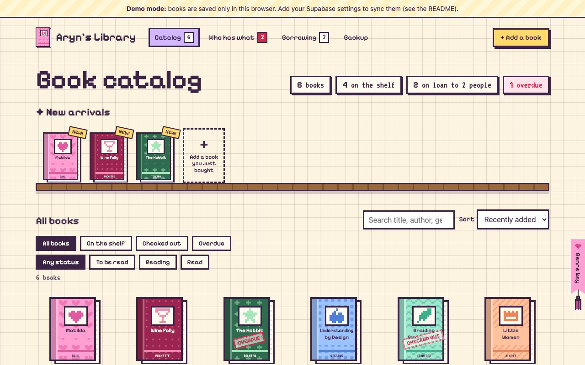
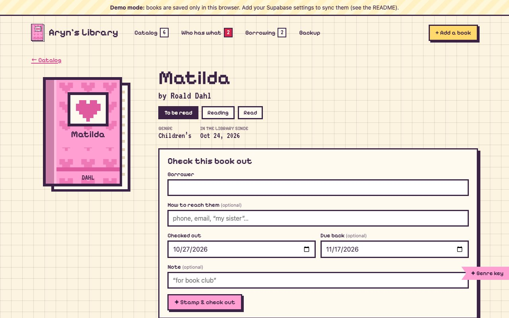
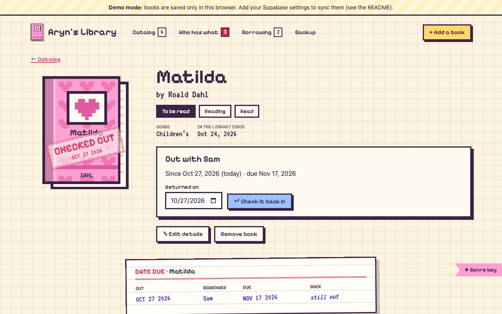
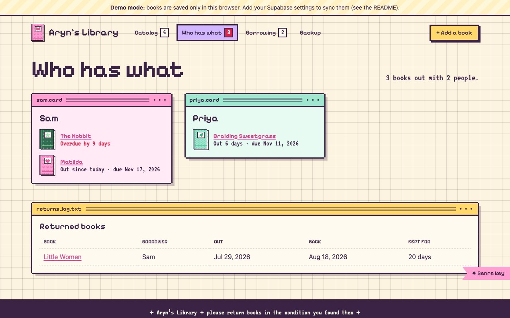
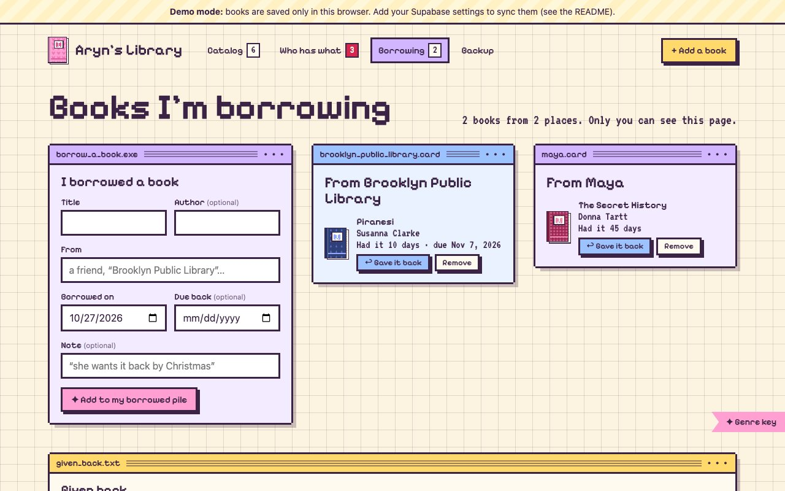
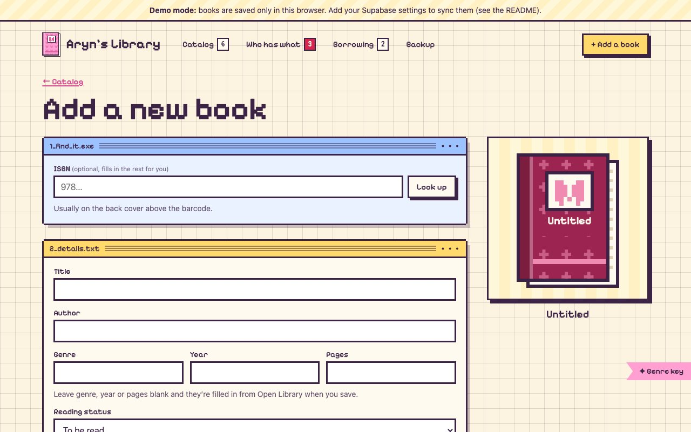
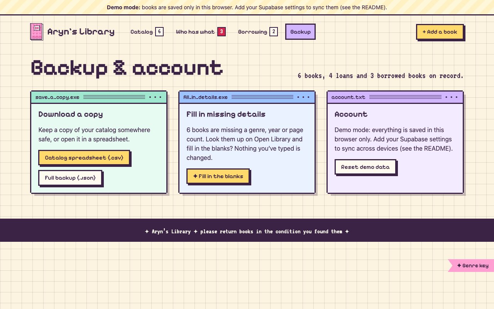
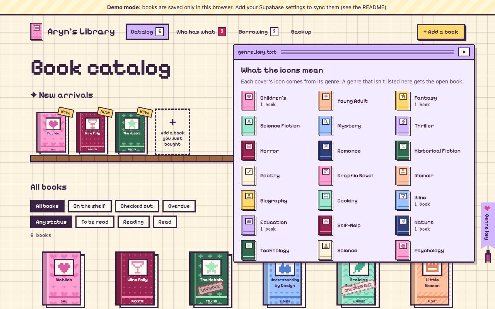

# Aryn’s Library 📚

Live at **[library.arynlynn.com](https://library.arynlynn.com)**.

A cozy, pixel-art catalog for my physical book collection. It keeps track of every book I own, which ones I’ve lent out, who has them, and for how long.

- **Book catalog:** every book as a cute pixel cover with a little icon for its genre, its title and the author's last name, plus search, filters (on the shelf, checked out, overdue) and sorting. Long titles drop the subtitle, wrap to three lines and end with “…”.
- **Genre key:** the **✦ Genre key** bookmark on the edge of every page opens a key to the icons, with how many of your books are in each genre. A genre that isn't on the list gets the open book.
- **New arrivals shelf:** books added in the last 45 days, plus a quick “add a book you just bought” slot.
- **Add books fast:** type an ISBN to fill in the title, author, genre, year and pages from [Open Library](https://openlibrary.org). Then pick a cover color and pattern (or hit **Surprise me**) and watch the preview update. Use **Add & start another** to enter a whole stack.
- **Details filled in for you:** add a book with the genre, year or pages left blank and they're looked up on Open Library (by ISBN, then by title and author). **Fill in missing details** on the Backup page does the same for books already in the library. Anything you typed is kept.
- **Reading status:** mark each book **Read**, **Reading** or **To be read** with one tap on its page, and filter the catalog by it. New books start as To be read.
- **Lending:** check a book out to someone with an optional due date. A rubber stamp slams onto the cover, and **RETURNED** stamps it when it comes back. Every book has an old-school pocket library card showing its loan history.
- **Who has what:** a card for each person who has books, with how long they’ve had them; overdue books come first. Below it is a log of past returns.
- **Borrowing:** the books you’re borrowing, grouped by who or where they’re from (a friend, the public library), with due dates, a **Gave it back** button and a log of what you’ve returned. Private: only you see it.
- **Backup:** download the catalog as a spreadsheet (CSV) or a full JSON backup (books, loans and borrowed books).

Built with React, TypeScript, Vite, and [Supabase](https://supabase.com) for storage and login.

## Screenshots

Taken in demo mode (sample books) from the production build at 1280×800. Update them whenever a page's look changes (they live in `docs/screenshots/`).

| Book catalog | Book page |
| --- | --- |
|  |  |
| **Checked out (stamp and date-due card)** | **Who has what** |
|  |  |
| **Borrowing** | **Add a book** |
|  |  |
| **Backup** | **Genre key** |
|  |  |

## Run it

Requires Node.js LTS and npm.

```sh
npm install
npm run dev       # http://localhost:5173
npm run build     # type-check and build to dist/
npm run preview   # serve the production build
npm run lint      # ESLint (TypeScript + React hooks rules)
npm test          # unit tests (Vitest)
```

Every pull request runs lint, type-check, tests and a build in GitHub Actions (`.github/workflows/ci.yml`).

**What the tests cover** (`npm test`):
- **Storage contract** (`src/lib/store.contract.test.ts`): the demo store and the Supabase store pass the same suite.
  - Add, edit and delete books (deleting a book removes its loans).
  - Check out and check in, refusing a double checkout or a second check-in.
  - Borrowed books: add, give back (only once) and remove.
  - The Supabase store runs against an in-memory fake client (`src/test/fakeSupabase.ts`) that mirrors the database constraints (one open loan per book, deletes cascading to loans) and Supabase's row limit. It's also tested on paging past that limit, the public view (no borrower details), and passing database errors on.
- **Demo store failures:** corrupt, full or blocked browser storage, and two tabs saving at once.
- **Older databases and saved demo libraries** still load before the October 2026 update: books without a reading status, and borrowing marked not set up.
- **Covers:** fitting titles and author names (subtitles dropped, three lines, a gentle squeeze, then “…”), and which icon each genre gets, including aliases like Sci-Fi and Kids.
- **Open Library lookup**, including dropped connections, genres picked from real subject lists, title searches that refuse a different book, and filling in only what's blank; ISBNs, dates, overdue loans, and the CSV export (including spreadsheet formula defusing).

Without Supabase settings the app runs in **demo mode**: sample books, saved only in that browser.

## Supabase setup (one time)

1. Create a Supabase project.
2. **SQL Editor → New query:** paste in [`supabase/schema.sql`](supabase/schema.sql) and run it. This creates the `books` and `loans` tables and turns on Row Level Security, so each signed-in user can only see and change their own rows.
3. **Authentication → Users → Add user:** create your account, with **Auto Confirm User** checked.
4. **Authentication → Sign In / Providers:** turn **off** “Allow new users to sign up”.
5. **SQL Editor → New query:** paste in [`supabase/public-view.sql`](supabase/public-view.sql) and run it, after creating your account. This makes the library **public and read-only**:
   - Anyone can browse your books, and see which are checked out and when they're due.
   - Borrower names, contact details and loan notes stay private.
   - Only you, signed in, can add, edit, lend or delete.
   - It sets your account (the project's only user) as the owner.
   - Until this is run, the app asks visitors to sign in before showing anything, as before.
6. **SQL Editor → New query:** paste in [`supabase/update-2026-10.sql`](supabase/update-2026-10.sql) and run it. It adds reading status to books (visible to visitors) and the private `borrowings` table. If you set things up before October 2026, run just this step. Until it's run, the app still works, but borrowing asks you to run it, and saving a book needs it.
7. Copy `.env.example` to `.env.local` and fill in the **Project URL** and the **publishable key**. `.env.local` is gitignored.

The publishable key is meant to be public; the database rules protect your data. **Never** put the secret / `service_role` key in this app or repo.

When deploying, set the same two `VITE_SUPABASE_…` variables in the host’s build settings.

**Signing in:** visitors see the catalog and book pages. You sign in with **Librarian sign in** in the header. Adding a book, editing, lending, **Who has what** and **Backup** also ask you to sign in.

## Deploy on Netlify

1. In Netlify, **Add new site → Import an existing project → GitHub** and pick this repo. `netlify.toml` already sets the build (`npm run build`, publish `dist`, Node 22) and the rule that lets links like `/loans` load directly.
2. **Environment variables** (Site configuration → Environment variables): add `VITE_SUPABASE_URL` and `VITE_SUPABASE_PUBLISHABLE_KEY`, the same values as `.env.local`. Without them the site builds in demo mode. Then **Deploys → Trigger deploy**, because the values are baked in at build time. Never add the `service_role` / secret key.
3. **Domain:** Site configuration → Domain management → **Add a domain** `library.arynlynn.com`. The domain uses Netlify DNS, so Netlify adds the record itself. HTTPS is set up automatically.
4. **Supabase:** in Authentication → URL Configuration, set **Site URL** to `https://library.arynlynn.com` so any emails Supabase sends link to the right place.

## Security

- **Row Level Security:** every row has an `owner_id`, and the policies only allow the signed-in owner to read or write it. Signed-out visitors are denied entirely. A book can only have one open loan at a time, which the database enforces.
- **Content Security Policy:** the app may only load its own files, and may only connect to your Supabase project and Open Library. It sends no third-party scripts, fonts or analytics. `npm run build` writes these headers to `dist/_headers` for hosts that read that file (Cloudflare Pages, Netlify).
- **CSV export:** cells are quoted, and values starting with `=`, `+`, `-` or `@` are defused so spreadsheet apps can’t run them as formulas.
- `noindex`: search engines are asked not to index the app.

## Customize

- Library name, default loan length, and the New Arrivals window: [`src/config.ts`](src/config.ts)
- Cover colors and patterns: [`src/components/BookCover.tsx`](src/components/BookCover.tsx). If you add one, also add it to `src/lib/types.ts` and the check constraint in `supabase/schema.sql`.
- Genre icons (7 × 7 pixel drawings) and the other names a genre can go by: [`src/lib/genreIcons.ts`](src/lib/genreIcons.ts).

## Ideas

See the [issues](https://github.com/aryndavis/bookshelf/issues), such as adding books by text message.

## License

MIT. See [LICENSE.md](LICENSE.md).
